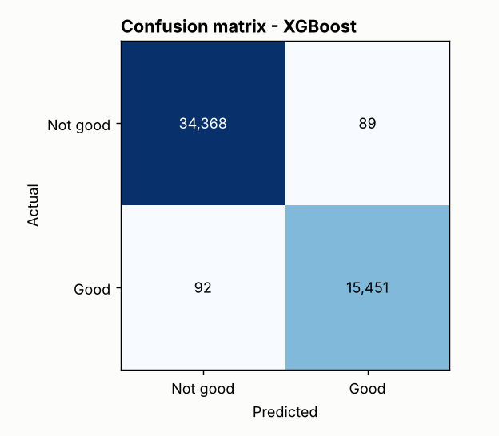
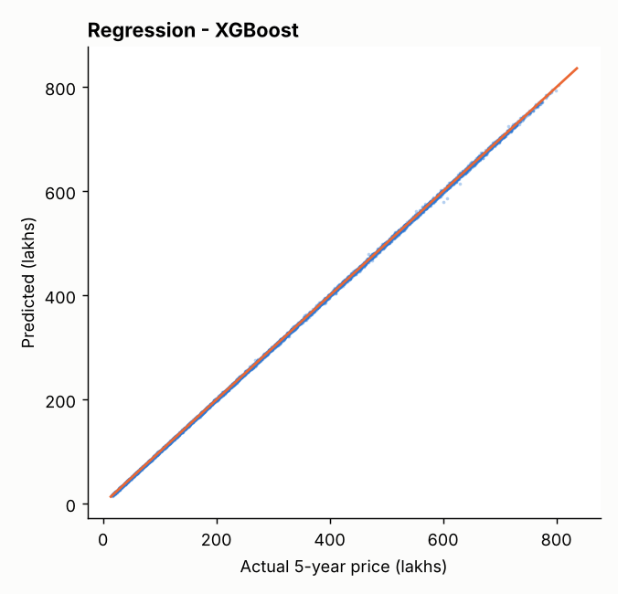

# 1. Problem statement

Build a machine-learning application that helps potential investors make real-estate decisions by

1. **classifying** whether a property is a *Good Investment*, and
2. **predicting** its estimated price after 5 years,

using the supplied dataset `india_housing_prices.csv`, with a Streamlit front end and MLflow experiment tracking.

# 2. Business use cases

- Give investors an instant, data-backed second opinion on the long-term return of a listing.
- Help buyers shortlist high-return properties (filter by state, city, BHK, price, area).
- Let real-estate companies automate first-pass investment screening of new listings.
- Increase customer trust by showing confidence scores and the factors behind each recommendation.

# 3. Data

| Item | Value |
|---|---|
| Source | `india_housing_prices.csv` (supplied) |
| Size | 250,000 properties x 23 columns |
| Coverage | 20 states, 42 cities, 500 locality labels per city |
| Missing values / duplicates | none found |
| Property types | Apartment, Independent House, Villa (about one-third each) |

# 4. Methodology

## 4.1 Preprocessing (`src/01_data_preprocessing.py`, `src/features.py`)

- **Missing values and duplicates:** handled by code (median/mode imputation; duplicates compared ignoring `ID`). None were present in this file.
- **Consistency fixes:**
    - `Age_of_Property` re-derived from `Year_Built` (base year 2025, which the file itself uses).
    - `Price_per_SqFt` in the raw file is in lakhs per sq ft, so it was recomputed in INR/sq ft.
    - 116,304 rows (46.5%) had `Floor_No` > `Total_Floors`; they were capped at the top floor and flagged.
- **Outliers:** IQR rule on price, size and price/sq ft. Only price/sq ft has outliers (19,723, all high-side); they are valid small expensive flats, so they are flagged and kept.
- **Scaling and encoding:** `StandardScaler` for 24 numeric features and one-hot encoding for City, Property_Type, Furnished_Status, Facing and Owner_Type, inside a scikit-learn `Pipeline` so raw inputs can be scored directly.

## 4.2 Feature engineering

| Feature | Definition |
|---|---|
| Price_per_SqFt_INR | price (lakhs) x 100,000 / size |
| Amenity_Count + 5 flags | parsed from the Amenities text |
| Parking_Flag, Security_Flag, Under_Construction_Flag | Yes/No to 0/1 |
| Transport_Score | Low=1, Medium=2, High=3 |
| Infrastructure_Score | mean of schools/10, hospitals/10 and transport (0-1) |
| School_Density_Score | nearby schools relative to the city average |
| Floor_Ratio, Size_per_BHK | floor / total floors; size / BHK |
| PPSF_vs_City_Median | price/sq ft relative to the city median (value indicator) |

## 4.3 Target creation (domain rules)

The dataset contains neither a future price nor an investment label, so both are derived from an explicit,
editable rule in `src/config.py`.

**Expected annual appreciation (% per year)** = 5.0 base
+ transport (Low 0 / Medium 1 / High 2)
+ 2.0 x (schools + hospitals) / 20
+ 1.0 if under construction
+ 1.0 if price/sq ft is at or below the city median
+ 0.3 security + 0.3 parking + 0.2 per amenity
- 1.5 x age / 35, clipped to 2-15%.

- **Future_Price_5Y_Lakhs** = price x (1 + growth)^5.
- **Good_Investment** = 1 if growth >= 8.5% per year **and** price/sq ft <= 1.2 x city median. This gives 31.1% positives (77,715 of 250,000 properties).

## 4.4 Modelling (`src/03_train_models.py`)

- 80/20 train/test split (random_state 42, stratified on the label): 200,000 train / 50,000 test.
- Classification: Logistic Regression, Random Forest, XGBoost. Regression: Ridge, Random Forest, XGBoost.
- Selection: highest F1 (classification), lowest RMSE (regression), on the held-out test set.
- **MLflow:** each model is one run (parameters, metrics, feature-importance table, model artifact with signature); winners are registered as `real_estate_investment_classifier` and `real_estate_price_forecaster`.

# 5. Results

**Classification (50,000 test properties)**

| Model | Accuracy | Precision | Recall | F1 | ROC-AUC |
|---|---|---|---|---|---|
| **XGBoost** | **0.9964** | 0.9943 | 0.9941 | **0.9942** | 0.9999 |
| Random Forest | 0.9860 | 0.9782 | 0.9766 | 0.9774 | 0.9992 |
| Logistic Regression | 0.9198 | 0.8773 | 0.8625 | 0.8698 | 0.9768 |

Majority-class baseline accuracy: 0.689.

**Regression (price after 5 years, lakhs)**

| Model | RMSE | MAE | R² | MAPE % |
|---|---|---|---|---|
| **XGBoost** | **1.78** | 1.32 | 0.9999 | 0.53 |
| Random Forest | 6.38 | 4.67 | 0.9990 | 1.41 |
| Ridge | 12.79 | 9.69 | 0.9961 | 6.30 |

"No growth" baseline (future price = today's price): RMSE 138.6 lakhs.

{width=40%}
{width=40%}

**Feature importance.** The classifier relies most on `PPSF_vs_City_Median` (28%), `Transport_Score` (12%), `City` (9%) and `Infrastructure_Score` (9%); the regressor is dominated by today's price (91%).

# 6. Exploratory data analysis - key findings

All 20 questions of the brief are answered with a chart and numbers in `reports/eda_findings.md` (charts in `reports/figures/`).
Highlights:

- **Price and size** are flat/uniform: 10-500 lakhs (mean 254.6) and 500-5,000 sq ft (mean 2,750). Size and price are uncorrelated (r = -0.003), so price/sq ft falls as size rises (r = -0.61).
- **Outliers:** only price/sq ft (7.9% of rows, high side).
- **Location:** price differences between states (2.5%) and between cities (3.1%) are tiny. Bangalore has the highest average price (258.5 lakhs) and Cuttack the lowest (250.8).
- **Feature relationships:** schools, hospitals, furnishing, facing, parking and amenities have no measurable effect on price or price/sq ft (all |r| < 0.01 on the original columns).
- **Ownership / availability:** Broker 83,479, Owner 83,268, Builder 83,253; Under Construction 125,035, Ready to Move 124,965.
- **Investment view (rule-driven):** public transport is the strongest lever: Good-Investment share is 9% (Low), 31% (Medium), 52% (High). Larger homes qualify more often (8% for 500-1,000 sq ft up to 51% for 4,000-5,000 sq ft) because they have lower price/sq ft.
- The brief's **crime-rate** analysis was replaced by the **Security** flag as a safety proxy, since no crime column exists.

# 7. Streamlit application

`app/streamlit_app.py` has four tabs: Investment Advisor (form, verdict with confidence gauge, 5-year price with trend line, key facts, feature importance), Property Explorer (filters + CSV download), Market Insights (heatmaps and trend charts), and Model Performance. The app was tested headlessly and in a browser; its single-property feature path was checked against the training data (0 feature or label mismatches on a 300-row sample).

# 8. Limitations - what these results do and do not mean

1. **The targets are rule-based.** Both targets are deterministic functions of the input features, so the near-perfect accuracy shows the models recovered the rule. It is **not** evidence that they can forecast the real property market.
2. **The original features carry no price signal** (pairwise |r| < 0.01), which is typical of synthetic data. No model could truthfully forecast real prices from them.
3. The rule's weights and thresholds are assumptions chosen for this project; change them in `config.py` to test other views.
4. There are no dates, so trend charts use construction period. There is no crime column, so Security is used as a proxy.
5. `Locality` is not a model input: names repeat in every city and carry no signal.
6. This is a decision-support demonstration, not financial advice.

# 9. Reproducing the work

```
pip install -r requirements.txt
bash run_all.sh
streamlit run app/streamlit_app.py
mlflow ui --backend-store-uri sqlite:///mlflow.db
```

# 10. Deliverables checklist

| Required by the brief | Where |
|---|---|
| Cleaned and processed dataset | `data/processed/housing_cleaned.csv` |
| Python scripts for EDA, training, evaluation | `src/01_...py`, `src/02_eda.py`, `src/03_train_models.py` |
| Streamlit application | `app/streamlit_app.py` |
| Project documentation | `README.md`, `docs/PROJECT_REPORT.md` / `.docx`, `reports/eda_findings.md` |
| MLflow tracking | code in `src/03_train_models.py`; `mlflow.db` and `mlartifacts/` are created when you run it (not bundled because they store machine-specific paths); run log in `reports/training_log.txt` |
